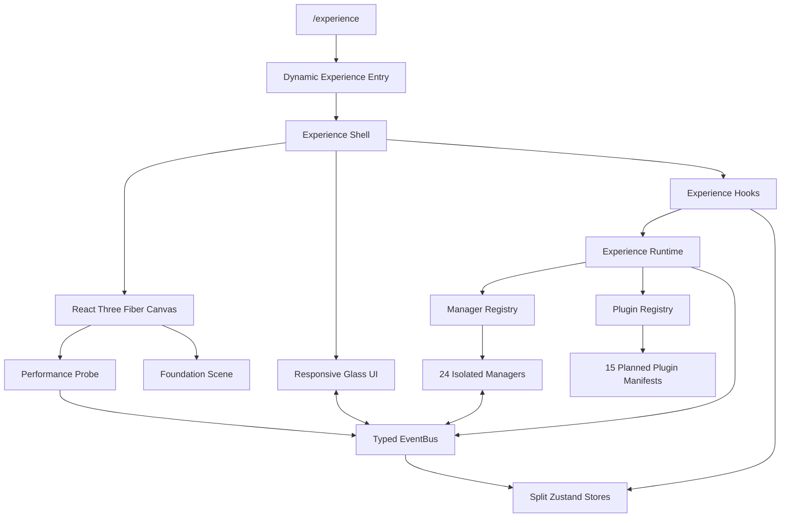

# SmartHive Experience Engine Foundation

## Scope

This milestone establishes the browser runtime for the SmartHive Experience Engine (SHE). It intentionally contains no house, smart devices, automation behavior, AI behavior, or production plugins.

## Folder Tree

```text
app/experience/
  error.tsx
  loading.tsx
  page.tsx
components/experience/
  controls/
    camera-preset-control.ts
  core/
    experience-canvas.tsx
    experience-entry.tsx
    experience-shell.tsx
  loading/
    experience-loading.tsx
  managers/
    animation-manager/
    asset-manager/
    audio-manager/
    automation-manager/
    camera-manager/
    debug-manager/
    device-manager/
    effects-manager/
    environment-manager/
    experience-manager/
    input-manager/
    lighting-manager/
    loading-manager/
    lod-manager/
    material-manager/
    memory-manager/
    notification-manager/
    performance-manager/
    physics-manager/
    plugin-manager/
    scene-manager/
    scene-preset-manager/
    selection-manager/
    theme-manager/
  overlays/
    debug-overlay.tsx
    notification-stack.tsx
  plugins/
    future-plugins.ts
  scene/
    camera-rig.tsx
    foundation-scene.tsx
    performance-probe.tsx
  ui/
    bottom-status-bar.tsx
    floating-action-button.tsx
    icons.tsx
    left-navigation.tsx
    right-inspector.tsx
    top-toolbar.tsx
hooks/experience/
lib/experience/
  stores/
public/experience/
  audio/ environment/ hdr/ icons/ shaders/ textures/
styles/experience/
types/experience/
```

## Architecture



Managers never import or call other managers. The runtime is the composition root, and all manager communication uses the typed EventBus. Each manager owns its subscriptions, lifecycle, public API, error boundary, degraded fallback state, and cleanup.

## State Stores

- Experience Store: runtime status, mode, and manager count.
- Camera Store: camera preset and pose.
- Selection Store: selected entity metadata only.
- Settings Store: shadows, reduced motion, and pixel ratio.
- Performance Store: renderer telemetry and quality preference.
- Plugin Store: registered plugin manifests and enabled state.
- Theme Store: isolated light/dark experience theme.

## Plugin Foundation

The registry automatically registers manifests for Lighting, Security, Curtains, HVAC, Pool, Garden, Solar, Energy, Garage, Gate, Water, Voice Assistant, AI Assistant, Camera System, and Analytics. All are marked `planned`, disabled, and contain no feature implementation.

## Scene Foundation

The scene contains only:

- Grey floor.
- Procedural high-dynamic-range environment lighting.
- Sky.
- Directional sun.
- Ambient light.
- Soft shadows.
- Orbit camera.

Default, Top, Front, Rear, Left, Right, and Perspective camera presets are enabled. First Person and Walk Mode are registered but disabled.

## Dependencies

| Package | Version | Purpose |
| --- | ---: | --- |
| Next.js | 15.5.19 | App Router and secure production runtime |
| React / React DOM | 19.2.7 | UI runtime |
| Three.js | 0.181.0 | WebGL renderer without current runtime deprecation warnings |
| React Three Fiber | 9.6.1 | React renderer for Three.js |
| Drei | 10.7.7 | Environment, sky, shadows, and orbit controls |
| Zustand | 5.0.14 | Split client state stores |
| Framer Motion | 11.18.2 | Interface transitions |
| React Spring Three | 10.1.1 | Camera preset transitions |
| React Three Postprocessing | 3.0.4 | Postprocessing pipeline readiness |
| Leva | 0.10.1 | Developer control pipeline readiness |
| React Use | 17.6.1 | Input and media hooks |
| UUID | 11.1.1 | Stable notification/event identifiers |
| Tailwind CSS | 3.4.x | Existing utility styling system |

All dependency peer ranges resolve cleanly. `npm audit` reports zero vulnerabilities.

## Performance Report

Measured in headless Chromium at 1280 x 720 using the development runtime:

| Metric | Observed |
| --- | ---: |
| Frame rate | 59-60 FPS |
| Draw calls | 2 |
| Triangles | 14 |
| Scene objects | 5 |
| Geometries | 15 |
| Textures | 5 |
| JavaScript heap snapshot | 114.2 MB |

The scene uses demand-free lightweight geometry, capped device pixel ratio, lazy route loading, automatic cleanup, soft-shadow controls, and a renderer telemetry loop sampled twice per second. LOD, memory pressure, effects, asset, and loading managers are ready for later milestone implementations.

## Bundle Impact

Measured from the production Next.js build:

| Bundle surface | Size |
| --- | ---: |
| `/experience` route shell | 1.73 kB |
| Initial first-load JavaScript | 104 kB |
| Deferred experience runtime | 1,133.63 KiB raw |
| Deferred experience runtime | 321.14 KiB gzip |

Three.js and the experience runtime are excluded from the initial route shell and loaded through a client-only dynamic boundary. Existing non-experience routes do not eagerly load the SHE runtime.

## Verification

- `npm run lint`: pass, zero warnings.
- `npx tsc --noEmit`: pass.
- `npm run build`: pass, zero warnings.
- `npm audit`: zero vulnerabilities.
- Desktop browser: pass, no console errors or framework overlay.
- Mobile browser: pass at 390 x 844.
- Camera presets, theme switch, reset control, Shift+D diagnostics, route exit cleanup, and home navigation: pass.
- Isolated PostgreSQL smoke test: registration, case-insensitive sign-in, dashboard, device catalog, quote save, and saved quote view pass.

## Remaining Milestones

The following remain untouched:

- House and architectural model.
- Rooms and room selection behavior.
- Smart device implementations.
- Automation execution.
- AI and voice assistants.
- Security, HVAC, curtains, pool, garden, solar, energy, garage, gate, water, camera, and analytics features.
- Physics simulation.
- First-person and walk navigation.
- Production HDR, texture, audio, icon, environment, and shader assets.
- Texture compression and production LOD policies.
