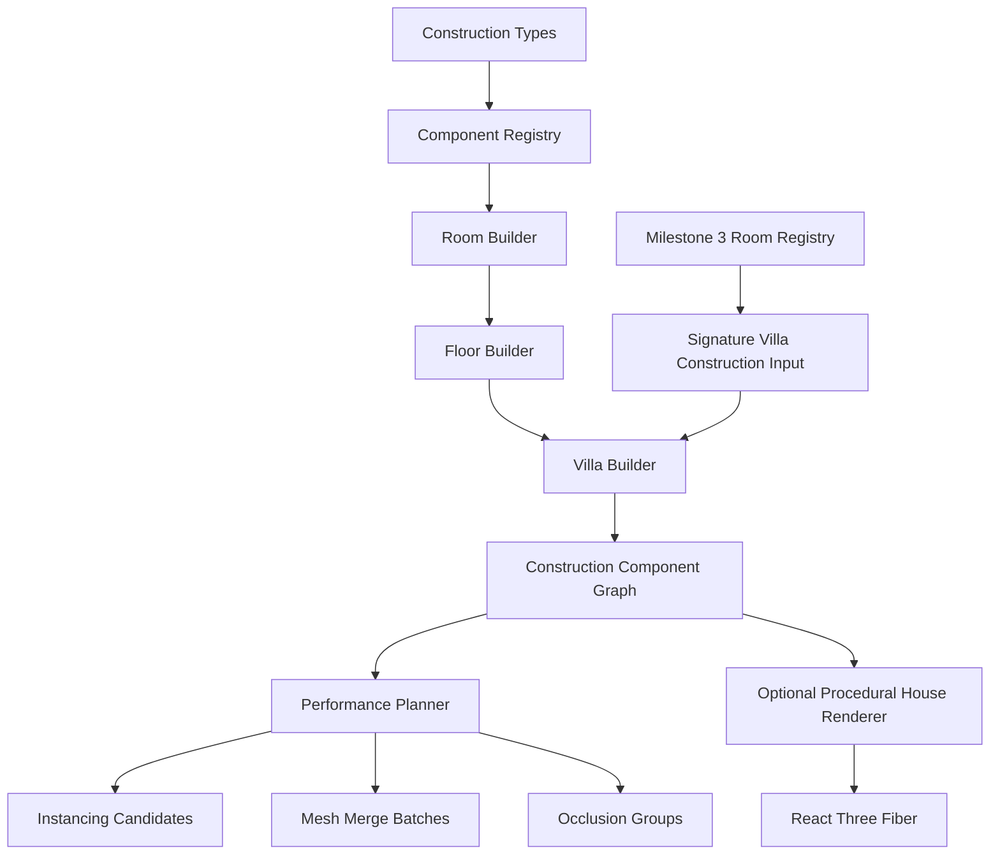

# SmartHive Experience Engine - Milestone 4

## Smart Construction System

Milestone 4 adds a modular construction system for the SmartHive Experience Engine. It does not rewrite or modify the completed exterior or interior generators. Instead, it introduces a reusable construction layer that can generate villas, apartments, offices, hotels, malls, hospitals, and future commercial buildings from shared component definitions.

The live Signature Villa remains visually preserved. The new construction system is available as a reusable engine layer and optional renderer.

## Scope Boundary

Implemented inside the Experience Engine only:

- `types/experience/construction.ts`
- `lib/experience/construction`
- `components/experience/construction`
- `public/experience/SHE_CONSTRUCTION_SYSTEM.md`

No authentication, quotation system, PDF, landing-page, API, database, completed exterior generator, or completed interior generator files were changed for Milestone 4.

## Universal Component Contract

Every construction component supports:

- Width
- Height
- Depth
- Thickness
- Material
- Rotation
- Elevation
- Visibility
- LOD
- Collision
- Shadow
- Reflection

Core type:

- `ConstructionComponentParameters`

## Reusable Component Registry

The construction registry defines reusable generators for:

- Foundation
- Concrete Slab
- Walls
- Internal Walls
- External Walls
- Glass Walls
- Columns
- Beams
- Roof Panels
- Flat Roof
- Floating Roof
- Ceilings
- Ceiling Recess
- Floors
- Skirting
- Doors
- Sliding Doors
- Pivot Doors
- Garage Doors
- Windows
- Curtain Walls
- Balustrades
- Balconies
- Terraces
- Swimming Pool
- Water Features
- Staircase
- Elevator
- Garden
- Fence
- Gate
- Driveway
- Landscape

Source:

- `lib/experience/construction/component-registry.ts`

## Builder Pipeline

```text
Room Builder
  -> Floor Builder
    -> Villa Builder
      -> Procedural House Generator
```

### Room Builder

Input:

- Length
- Width
- Height
- Door position
- Window position
- Ceiling type
- Floor material

Output:

- Complete room component graph
- Floor
- Walls
- Doors
- Windows
- Ceiling
- Ceiling recess where applicable
- Skirting
- Area and volume
- Bounds

Source:

- `lib/experience/construction/room-builder.ts`

### Floor Builder

The Floor Builder groups rooms by floor and adds:

- Concrete slab
- Roof or floor panel
- Floor-level component graph

Source:

- `lib/experience/construction/floor-builder.ts`

### Villa Builder

The Villa Builder assembles:

- Foundation
- All floors
- Staircase
- Elevator
- Site components
- Metrics

Source:

- `lib/experience/construction/villa-builder.ts`

## Procedural House Generator

The SmartHive Signature Villa construction graph is generated from the Milestone 3 room registry. This keeps the completed visual interior intact while making the building reusable as structured construction data.

Source:

- `lib/experience/construction/signature-villa-generator.ts`
- `components/experience/construction/procedural-house-generator.tsx`

## Future Building Support

The build system defines presets for:

- 2 Bedroom
- 3 Bedroom
- 4 Bedroom
- 5 Bedroom
- Duplex
- Bungalow
- Penthouse
- Office
- Mall
- Hospital

Source:

- `lib/experience/construction/building-presets.ts`

## Performance System

Milestone 4 adds construction-level performance planning:

- Instanced geometry candidates
- Geometry reuse keys
- Automatic mesh merge batches
- Occlusion groups
- LOD-ready component counts
- Collision component counts

Source:

- `lib/experience/construction/performance-planner.ts`

The construction renderer is optional and not mounted in the live scene, so Milestone 4 adds no new runtime render cost to `/experience` unless the renderer is explicitly used in a future milestone.

## Architecture Diagram



## Performance Report

The construction system is designed for future rendering optimization before visual mounting:

| Surface | Strategy |
| --- | --- |
| Repeated columns, beams, skirting, fence, stairs | Instancing candidates |
| Walls, slabs, floors by floor/material | Merge candidates |
| Rooms and floors | Occlusion groups |
| All components | LOD policy attached |
| Collision | Layered collision policy per component |
| Reflections | Explicit reflection policy for glass, water, and metal |

Milestone 4 verification:

- `npx tsc --noEmit`
- `npm run lint`
- `npm run build`

## Stop Point

Milestone 4 stops at the construction system. It does not change completed exterior or interior rendering and does not add quotation behavior, database writes, APIs, PDF behavior, smart devices, automation, voice, or AI.
