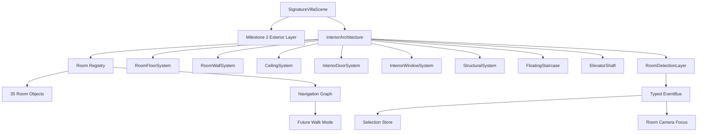

# SmartHive Experience Engine - Milestone 3

## Interior Architecture

Milestone 3 adds the complete procedural interior architecture for the SmartHive Signature Villa. It does not add furniture, decorations, smart devices, automation behavior, APIs, database changes, quotation changes, authentication changes, or landing-page changes.

The Milestone 2 exterior generators remain untouched. The interior is added as a separate architectural layer and rendered through the existing Experience Engine scene.

## Scope Boundary

Implemented inside the Experience Engine only:

- `components/experience/interior`
- `lib/experience/interior`
- `types/experience/interior.ts`
- Existing Experience Engine scene/event/camera files required to render and focus the interior layer
- `public/experience/SHE_INTERIOR_ARCHITECTURE.md`

## Complete Interior Layout

The room registry contains 35 room objects:

### Ground Floor

- Luxury Foyer
- Formal Living Room
- Family Lounge
- Dining Room
- Open Kitchen
- Dirty Kitchen
- Pantry
- Wine Cellar
- Laundry
- Guest Bedroom
- Guest Bathroom
- Powder Room
- Prayer Room
- Cinema
- Gym
- Home Office
- Storage
- Smart Utility Room
- Staircase
- Elevator Shaft
- Garage Connection
- Outdoor Patio Access

### First Floor

- Master Bedroom
- Luxury Walk-in Closet
- Luxury Bathroom
- Private Lounge
- Bedroom 2
- Bedroom 3
- Bedroom 4
- Shared Family Lounge
- Library
- Study Area
- Upper Circulation Bridge
- Balconies
- Terraces

## Room Registry

Every room is represented as a future-ready object with:

- Room ID
- Room name
- Area
- Volume
- Floor level
- Bounding box
- Ceiling height
- Floor material
- Camera focus pose
- Future smart device capability placeholders
- Future energy consumption profile
- Future quote mapping metadata

Current registry totals:

| Metric | Value |
| --- | ---: |
| Room objects | 35 |
| Registered area | 652.6 sqm |
| Registered volume | 2,186.5 cbm |
| Navigation edges | 30 |
| Floors | Ground + First |

Room registry source:

- `lib/experience/interior/room-registry.ts`

Navigation graph source:

- `lib/experience/interior/navigation-graph.ts`

## Architectural Systems

Procedural generators create:

- Wall thickness and room partition shells
- Door frames and door leaves
- Window openings and glass panels
- Ceiling slabs, ceiling recesses, and bulkheads
- Structural columns and beams
- Large-format marble floors
- Engineered wood floors
- Polished concrete service floors
- Bathroom tile zones
- Outdoor decking zones
- Acoustic cinema ceiling and floor treatment
- Luxury floating staircase
- Glass stair handrails
- Metal stair support
- Residential elevator shaft
- Machine-room-ready elevator cap

## Doors

Door architecture includes:

- Pivot door
- Sliding glass doors
- Bedroom doors
- Bathroom doors
- Hidden doors
- Pocket doors
- Garage connection door

## Windows

Window architecture includes:

- Operable windows
- Curtain wall panels
- Skylight
- Bathroom windows
- Office windows

## Navigation

Milestone 3 adds a future-walk-ready graph with explicit room-to-room edges:

- Open connections
- Door connections
- Sliding-glass transitions
- Stair transition
- Elevator transition
- Terrace transitions
- Hidden/pocket/garage transitions

The scene also includes automatic room detection volumes. Pointer movement over a room emits room selection events. Clicking a room emits a camera focus request for that room.

## Future Readiness

Each room is prepared for future implementation of:

- Lighting
- Curtains
- Air conditioning
- CCTV
- Sensors
- Locks
- Voice assistant
- AI
- Quotation mapping

These are metadata placeholders only. No smart devices, device behavior, automation, voice assistant, AI behavior, or quotation logic is implemented in this milestone.

## Architecture Diagram

## Stop Point

Milestone 3 stops after interior architecture. No furniture, decorations, smart devices, automation, AI, quotation behavior, or interior styling beyond architectural materials has been added.
