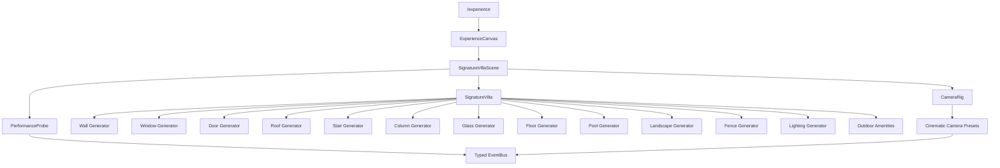

# SmartHive Experience Engine - Milestone 2

## SmartHive Signature Villa

Milestone 2 replaces the empty foundation scene with a permanent procedural exterior identity for SmartHive. The villa is generated entirely with reusable Three.js geometry. No GLB files, downloaded models, house templates, interior rooms, devices, automation, APIs, database changes, or AI behavior are included.

## Scope Boundary

Implemented inside the Experience Engine only:

- `app/experience`
- `components/experience`
- `lib/experience`
- `types/experience`
- `public/experience`

No authentication, quotation, PDF export, API, database, or landing-page files were modified.

## Villa Generator

The exterior is composed through configurable generators:

- Wall Generator: villa massing, garage, security house, accent planes, water wall.
- Window Generator: floor-to-ceiling glass with thickness, frames, and mullions.
- Door Generator: oversized pivot entry door with handle and pivot detail.
- Roof Generator: flat roofs, floating canopy, garage roof, terrace pergola.
- Stair Generator: front arrival steps and exterior garden stair.
- Column Generator: canopy, garage, and pergola support columns.
- Glass Generator: balcony, terrace, pool, and stair glass panels.
- Floor Generator: driveway, walkways, terraces, pool deck, outdoor dining deck.
- Pool Generator: infinity-style pool, animated water ripple, reflection lights.
- Landscape Generator: garden ground plane, palm trees, decorative planting, animated clouds, tree sway.
- Fence Generator: perimeter fence, instanced posts, sliding gate, gate rail.
- Lighting Generator: instanced bollards, facade lighting, warm exterior glows.

## Exterior Features

- Ultra luxury two-floor modern villa.
- Flat roof, concrete/travertine/stone massing, black steel accents.
- Large glass facades and panoramic upper-floor glazing.
- Covered garage and luxury front arrival court.
- Pivot front door and floating entry canopy.
- Swimming pool, travertine pool deck, water feature, pool light reflections.
- Outdoor lounge, fire pit, dining area, and BBQ station.
- Balconies, rear terrace, glass balustrades, outdoor stairs.
- Garden, palm trees, decorative plants, landscape lighting.
- Perimeter fence, automatic sliding gate, security house, driveway, walkways.

## Materials

All visible surfaces use PBR-capable Three.js materials:

| Material | Implementation |
| --- | --- |
| Concrete | `meshStandardMaterial` with high roughness |
| Travertine | warm stone `meshStandardMaterial` |
| Marble | low-roughness light stone `meshStandardMaterial` |
| Wood | warm roughness-balanced `meshStandardMaterial` |
| Tempered glass | `meshPhysicalMaterial` with transparency, thickness, transmission, clearcoat |
| Brushed aluminium | high-metalness `meshStandardMaterial` |
| Black steel | high-metalness dark `meshStandardMaterial` |
| Natural stone | high-roughness `meshStandardMaterial` |
| Water | `meshPhysicalMaterial` with animated roughness and clearcoat |

## Camera Presets

| Preset | Purpose |
| --- | --- |
| Front Arrival | Signature first impression from the entry court |
| Driveway | Gate-to-garage arrival composition |
| Pool | Rear pool and deck identity shot |
| Garden | Landscape and side architecture view |
| Aerial | Full site, roof, pool, and landscape overview |
| Front Door | Pivot door and canopy close-up |
| Backyard | Rear facade, terrace, and pool context |
| Terrace | Upper terrace/pergola cinematic angle |

## Animation

Milestone 2 keeps interaction out of scope and only adds subtle environmental movement:

- Slow cloud drift.
- Palm crown sway.
- Water surface ripple and changing roughness.

## Performance Strategy

- Procedural geometry only; no external model parse or asset loading cost.
- Reusable generator components with simple primitives.
- Instanced mesh use for fence posts and exterior bollard housings.
- Drei `Detailed` LOD used on palm trees for automatic distance-based simplification.
- Shadows remain controlled by the existing Experience Engine setting.
- Shadow map bounds expanded for the villa site while keeping 2048 resolution.
- Renderer telemetry remains sampled through the existing `PerformanceProbe`.
- Scene is occlusion-ready through grouped exterior zones and generator-level boundaries.

## Architecture Diagram

## Performance Report

Target remains 60 FPS. The scene is designed for low geometry complexity relative to a model-based villa because it uses primitives, instancing for repeated exterior hardware, sparse dynamic lighting, and distance LOD for palms.

Observed in Chromium through the existing Shift+D diagnostics panel after the lighting and shadow optimization pass:

| Metric | Observed |
| --- | ---: |
| Frame rate | 60 FPS |
| Draw calls | 366 |
| Triangles | 11,468 |
| Scene objects | 386 |
| Geometries | 217 |
| Textures | 6 |
| JavaScript heap snapshot | 152.4 MB |

Verification commands for this milestone:

- `npm run lint`
- `npx tsc --noEmit`
- `npm run build`
- Browser verification of `/experience`
